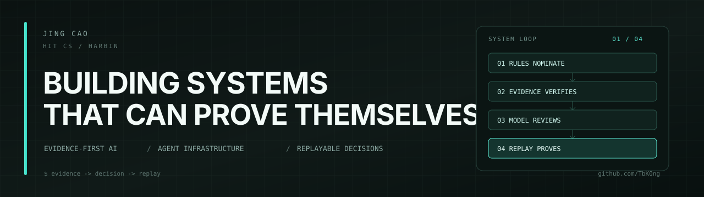
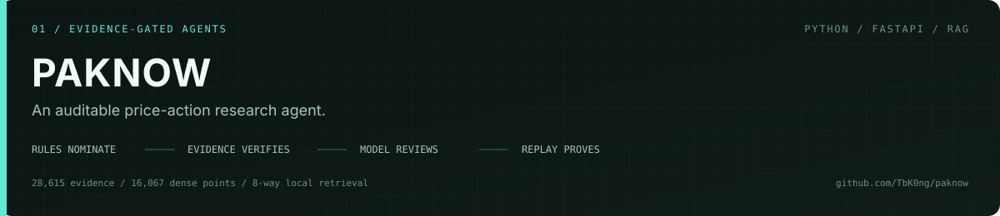
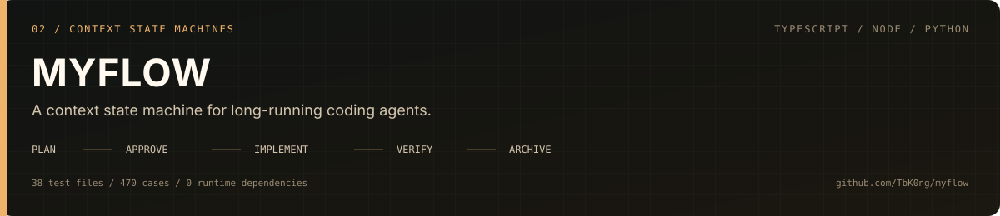

  

  
  
  
  

## I build AI systems that can prove themselves.

I am a Computer Science student at **Harbin Institute of Technology**. My work sits on the boundary between probabilistic models and deterministic systems: evidence before generation, state before action, replay before trust.

- **Evidence-first AI** — retrieval systems where every citation is traceable and verifiable.
- **Agent infrastructure** — harnesses that keep long-running tasks bounded, observable, and recoverable.
- **Deterministic execution** — rules nominate, models review, and code enforces.

---

## Selected work

<a href="https://github.com/TbK0ng/paknow">
  <picture>
    <source media="(max-width: 600px)" srcset="./assets/paknow-card-mobile.svg" />
    
  </picture>
</a>

**PAknow** is an auditable price-action research agent. Deterministic PA rules nominate candidates; PAknow retrieves and verifies evidence from six source books; an LLM is allowed to review only after support, risk, and confirmation evidence are complete; a paper replay then uses only the closed bars visible at signal time.

`Python` · `FastAPI` · `RAG` · `Qdrant` · `SQLite` · `Pydantic`

[Open the repository](https://github.com/TbK0ng/paknow) · [Read the architecture](https://github.com/TbK0ng/paknow#readme)

<a href="https://github.com/TbK0ng/myflow">
  <picture>
    <source media="(max-width: 600px)" srcset="./assets/myflow-card-mobile.svg" />
    
  </picture>
</a>

**myflow** is a context state machine harness for Pi coding agents. Workflow state lives in files; lifecycle hooks project only the state needed into each turn; plan hashes bind approvals, write scopes constrain parallel agents, and verify gates block premature completion.

`TypeScript` · `Node.js` · `Python` · `Pi extension` · `JSONL RPC`

[Open the repository](https://github.com/TbK0ng/myflow) · [Read the architecture](https://github.com/TbK0ng/myflow#readme)

---

## How I think about systems

> If a system cannot explain its evidence, it should not make the call.

| Principle | In practice |
| --- | --- |
| **Evidence before generation** | A model output is only useful when its sources can be hydrated and checked. |
| **State before action** | Long-running agents need an explicit workflow state, not an ever-growing conversation. |
| **Replay before trust** | A decision should be reproducible from the inputs visible at that moment. |

<b>Toolbox</b>

 

  Harbin · HIT CS · building in public

